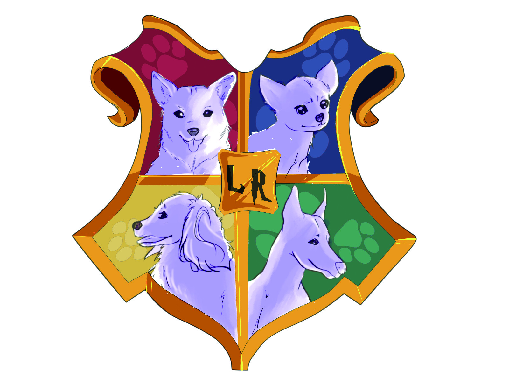

# Bowarts

**Aliados:** [Eutanatos](../../world/tradiciones/eutanatos.md)  
**Status:** Destruida  
**Objetivo:** Educar a los futuros magos

## Resumen

La escuela de magia mas importante, un lugar en el se reclutaban los magos que acababan de despertar y se les colocaban en diferentes casas según su importancia. Este sistema era fundamental para el control y estabilidad del mundo mágico, gracias a esto.

## Historia

Fue destruida por un Mago el cual ascendió, acabando con casi todos sus alumnos y profesores. Los pocos que salieron vivos no quisieron hablar mas del tema.

## Organizacion

Director: Encargado de supervisar y proteger la escuela.  
Profesor: Encargados de guiar a los alumnos.  
  
Estudiante:  Magos novicios que se dividían en 4 casas.

## Relaciones

[Eutanatos](../../world/tradiciones/eutanatos.md) : Asesinos que suele contratar Bowarts para acabar con amenazas.
