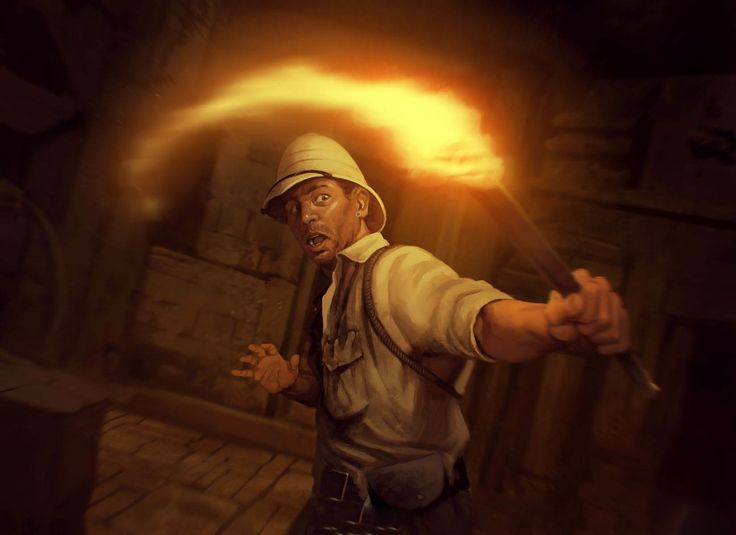

# Ashe

**Nacio el:** ?
**Vive en:** ?
**Nacionalidad:** ?
**Status:** Muerto  
**Ocupacion:** Arqueologo 
**Rango:** Despertado
**Personalidad:** 

*""*

## Resumen

Un arquelogo poseido por un antiguo dios. Es persegudio por un culto por esto.

## Historia

Trabajaba como arquelogo cuando en una tumba sagrada desperto al ser poseido por un dios antiguo.

## Relaciones

## Esferas

- Correspondencia: 4
- Entropia: 4
- Espiritu: 4
- Fuerzas: 4
- Primordial: 4
- Materia: 4
- Mente: 4
- Tiempo: 4
- Vida: 4

## Magia

Un antiguo dios de la decadencia posee a Ashe el cual termina.

## Hechizos

## Notas
