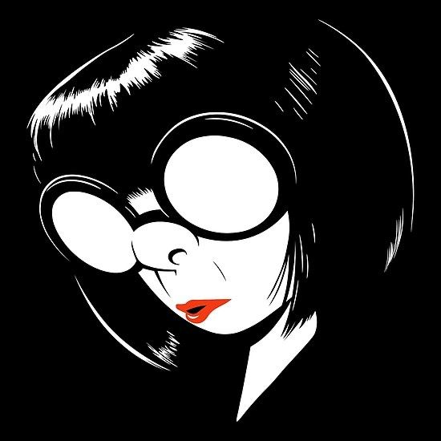

# Edna

**Nacio el:** ? 
**Vive en:** Buenas peras, Argentine
**Nacionalidad:** ?
**Status:** Viva  
**Ocupacion:** Modista
**Rango:** Maestro  
**Personalidad:** 

*\*Lo insulta en moda*\*

## Resumen

Una modista profesional que ve la ropa como el camino a la evolucion.

## Historia

Edna es una exitosa modista que revoluciono la industria. Un dia recivio una invitacion aun lugar extraño "Bowarts". El lugar era una especie de academia magica y ella habia sido invocada por error, Bowarts lo noto y la persiguio. Durante su escape Edna desperto su magia.

Asi fue como Edna comenzo a mejorar su capcidades mientras se mantenia lo mas oculta posible de Bowarts (Aunque llendo algunos festivales de moda).

En Buenas peras es contratada por Doc Sciencie para rescatar a los miembros de su equipo de la dimension 7, se entera de que uno de los miembros es de Bowarts. Luego de aventurarse encuentran su cadaver y en el una extraña llave de Bowarts. Mark combate y acaba con otro de los miembros del equipo y lo noquean. Al volver se desvubre que Watcher era una traidora y logran noquearla junto con Mark pero este logra matar al ultimo miembro de los rescatados.
Edna decide abandonar el lugar cansada de todo el conflicto.

## Relaciones

Mark: No confia mucho en el pero como lo encuentra capaz esta dispuesta a trabajar con el.

## Esferas

- Correspondencia: 2
- Entropia: 0
- Espiritu: 0
- Fuerzas: 0
- Primordial: 0
- Materia: 3
- Mente: 0
- Tiempo: 0
- Vida: 2

## Magia

Edna puede hacer todo tipo de mejoras a la ropa para tenerla funcional y a la moda.

## Hechizos

## Notas

Este es el primer personaje de David