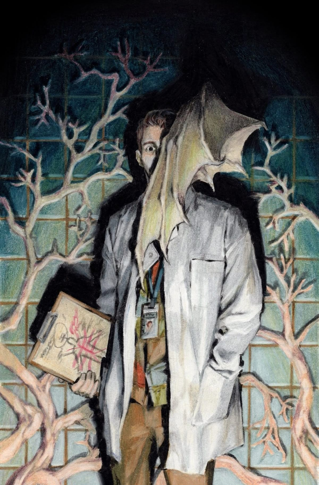

# Fransisco

**Nacio el:** ? 
**Vive en:** Buenas peras, Argentine
**Nacionalidad:** ?
**Status:** Muerto  
**Ocupacion:** Medico
**Rango:** Novato  
**Personalidad:** 

*\*"Absorbo su biomasa"*\*

## Resumen

Un medico dispuesto a lo que sea por evolucionar y sanar a su hermano.

## Historia

Fransisco y su hermano son muy unidos. De un momento a otro su hermano se enfermo gravemente, el deseo de Fransisco de sanarlo hizo que despertara. Desde entonces hace lo que sea para mejorar incluso encontrando una maestra.

## Relaciones

Hermano

## Esferas

- Correspondencia: 0
- Entropia: 0
- Espiritu: 0
- Fuerzas: 0
- Primordial: 0
- Materia: 0
- Mente: 0
- Tiempo: 1
- Vida: 2

## Magia

Fransisco cree en ser la forma de vida superior por lo que siempre intenta mejorarse y utilizarse.

## Hechizos

1- Transformar extremidades en armas de fuego, cuchillos o espadas.
2- Mover organos y tejido interno de lugar.
3- Crear formas de vida simples como un dron con alas y ojos que luego me transmita la información de lo que vio mediante un usb nervioso.

## Notas

Este es el primer personaje del Thomas