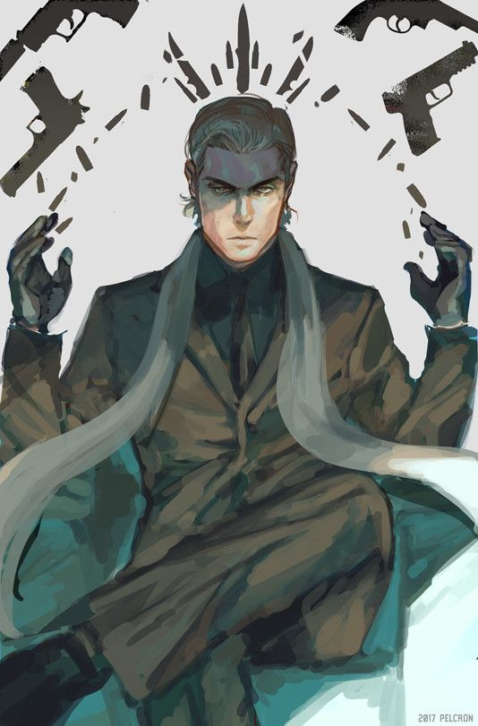

# Mark

**Nacio el:** ?
**Vive en:** ?
**Afiliaciones:** [Eutanatos](../../world/tradiciones/eutanatos.md)  
**Nacionalidad:** ?
**Status:** Muerto  
**Ocupacion:** Asesino a sueldo
**Rango:** Maestro  
**Personalidad:** 

*"Ya hice lo que vine a hacer"*

## Resumen

Un asesino a sueldo en busca de sentir miedo

## Historia

Mark nacio sin miedo, toda su vida la vio pasar sin sentir nada, hasta que un dia vio visiones de un lugar temible, extraño, unico, la umbra. En ese momento desperto sus capcidades y logro hacer que eventos poco probables pasaran.

Pronto fue contactado por un grupo que vio sus habilidades, los [Eutanatos](../../world/tradiciones/eutanatos.md). En un principio lo entrenaron luego lo inculcaron, aunque a Mark no le importaba mucho esto, vio la oportunidad de alcanzar el lugar que soño para poder sentir verdadero temor.

## Relaciones

[Watcher](../../world/personajes/watcher.md): Una de sus clientas.

## Esferas

- Correspondencia: 1
- Entropia: 3
- Espiritu: 0
- Fuerzas: 0
- Primordial: 1
- Materia: 1
- Mente: 0
- Tiempo: 0
- Vida: 1

## Magia

El cree que todo lo puede funcionar, no tiene miedo a fallar siempre termina logrando su objetivo.

## Hechizos

## Notas

Este es el primer personaje de Marcelo