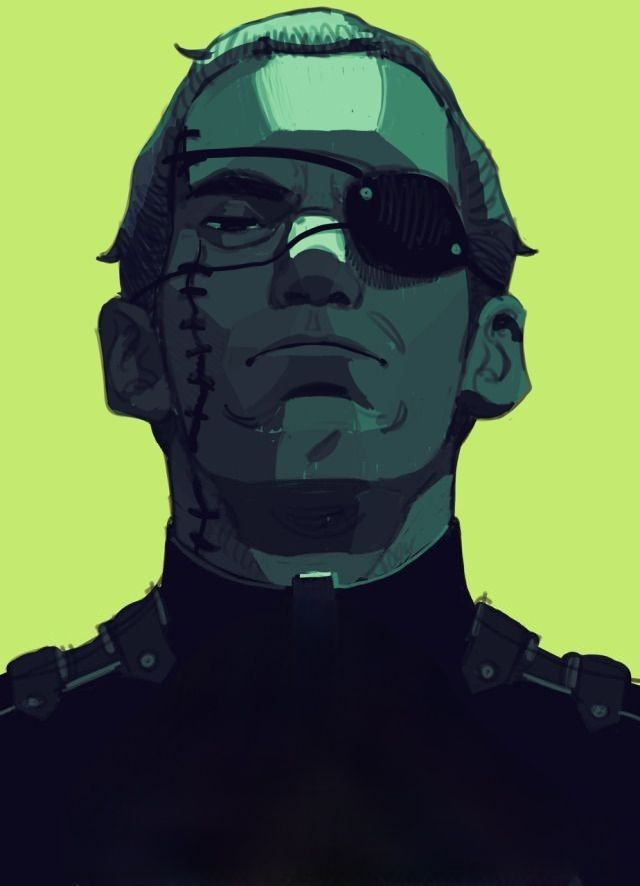

# Henrick

**Nacio el:** 15 Febrero  
**Vive en:** Buenas peras, Argentine
**Afiliaciones:** [Bowarts](../../world/empresas/bowarts.md)  
**Nacionalidad:** [Argentine](../../world/paises/argentine.md)  
**Status:** Muerto  
**Ocupacion:** Estudiante de ciencias aplicadas  
**Rango:** Iniciado  
**Personalidad:** Serio

*\*Aparece muerto*\*

## Resumen

Estudiante de ciencias, era el líder del grupo que fue a la Dimensión 7.

## Historia

Estudio en [Bowarts](../../world/empresas/bowarts.md) al salir se intereso en el estudio dimensional de [Doc Sciense](../../world/personajes/doc-sciense.md) 

Logro ser seleccionado como líder del equipo dimensional pero cuando empezaron a ocurrir problemas decidió el intentar volver, termino siendo devorado por una criatura. Su cuerpo fue encontrado por el equipo de rescate.

## Relaciones

[Doc Sciense](../../world/personajes/doc-sciense.md): Su profesor y objetivo de asombro.

[Watcher](../../world/personajes/watcher.md): Amable asistente del profesor.

[Valentine](../../world/personajes/valentie.md): Compañera de equipo.

[Naj](../../world/personajes/naj.md):  Compañero de equipo.

## Esferas

- Correspondencia: 0
- Entropia: 0
- Espiritu: 0
- Fuerzas: 2
- Primordial: 2
- Materia: 0
- Mente: 0
- Tiempo: 0
- Vida: 0

## Magia

Desconocido

## Hechizos

Desconocido

## Notas

El único personaje que comenzó muerto antes de empezar la sesión
