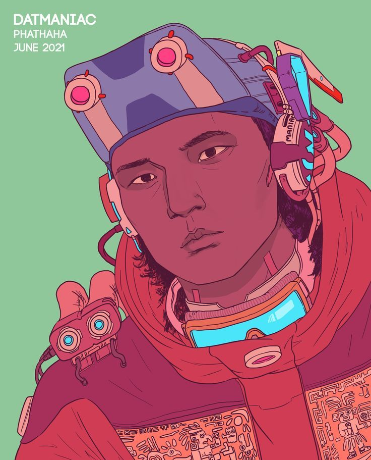

# Naj

**Nacio el:** 1 Septiembre  
**Vive en:** Buenas peras, Argentine
**Nacionalidad:** [Argentine](../../world/paises/argentine.md)  
**Status:** Muerto  
**Ocupacion:** Estudiante de ciencias aplicadas  
**Rango:** Novato  
**Personalidad:** Tímido

*"Creo que alguien nos saboteo"*

## Resumen

Estudiante de ciencias, era el informático del grupo que fue a la Dimensión 7.

## Historia

Estudiante de ciencias aplicadas que despertó en medio de una clase, [Doc Sciense](../../world/personajes/doc-sciense.md) le ayudo a realizar y mejorar sus capacidades. Fue seleccionado como experto en equipamiento para ir a la Dimension 7, cuando comenzaron a fallar las cosas en la mision, Naj comenzo a sospechar de Watcher que tambien tenia acceso, pero fue atrapado por criaturas y termino siendo salvado por Valentie y el equipo de rescate.

Como tenia desconfianza del grupo decidio llevar a Valentie a otro lado para conversar pero Mark del equipo de rescate la asesino y luego peleo con el, para su suerte fue salvado por el resto del grupo Edna y Fransisco. Llevaron a Mark hasta la salida del portal en donde confrontaron a Watcher, ahi Naj salio gravemente herido y cuando intentaron curarlo Mark desetabilizo la magia y le dio un ataque al corazon que acabo con su vida.

## Relaciones

[Doc Sciense](../../world/personajes/doc-sciense.md): Su profesor y objetivo de asombro.

[Watcher](../../world/personajes/watcher.md): Amable asistente del profesor.

[Valentie]: Su mejor amiga y compañera de equipo.

[Henrick](../../world/personajes/henrick.md): Compañero de equipo.

## Esferas

- Correspondencia: 0
- Entropia: 0
- Espiritu: 2
- Fuerzas: 0
- Primordial: 0
- Materia: 1
- Mente: 0
- Tiempo: 0
- Vida: 0

## Magia

El equipamiento de Naj tiene capacidades para ver y hablar con espíritus.  Además tiene herramientas para pasar otras cosas al mundo espiritual.

## Hechizos

Another Adventure: Puede hacer que su equipamiento se vuelva espiritual.

## Notas
