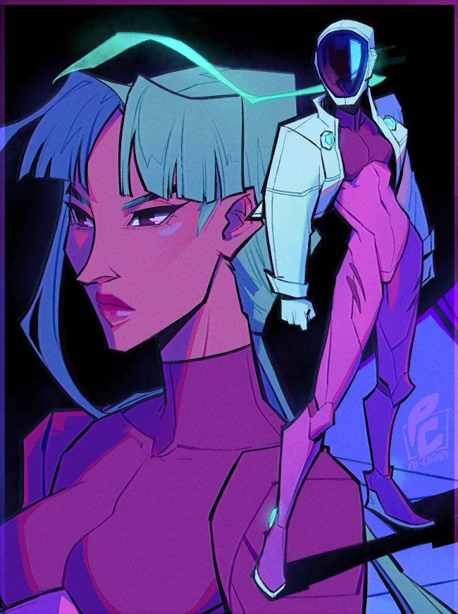

# Valentie

**Nacio el:** 13 Octubre  
**Vive en:** Buenas peras, Argentine
**Nacionalidad:** [Argentine](../../world/paises/argentine.md)  
**Status:** Muerto  
**Ocupacion:** Estudiante de ciencias aplicadas  
**Rango:** Iniciada  
**Personalidad:** Seria y enfocada

*\***Splat**\**

## Resumen

Estudiante de ciencias, era la peleadora del grupo que fue a la Dimensión 7.

## Historia

Estudiante con beca por deporte, [Doc Sciense](../../world/personajes/doc-sciense.md) la llamo por su gran habilidad como despertada, decidió empezar a estudiar ciencias aplicadas para poder estar mas con el grupo.

Al ir a la dimensión 7 fue la peleadora del grupo y combatió contra estas cuando atacaron la base que habían formado, cuando una de estas se llevo a [Naj](../../world/personajes/naj.md) ella salió corriendo para salvarlo.

Al encontrarse con el grupo de rescate se unió a ellos y juntos lograron salvar a [Naj](../../world/personajes/naj.md) pero cuando este quiso decirle algo en privado Mark hizo que ella se tropezara a gran altura y terminara muerta.

## Relaciones

[Doc Sciense](../../world/personajes/doc-sciense.md): Su profesor y objetivo de asombro.

[Watcher](../../world/personajes/watcher.md): Amable asistente del profesor.

[Naj](../../world/personajes/naj.md): Su mejor amigo y compañero de equipo.

[Henrick](../../world/personajes/henrick.md): Compañero de equipo.

## Esferas

- Correspondencia: 0
- Entropia: 0
- Espiritu: 0
- Fuerzas: 0
- Primordial: 0
- Materia: 0
- Mente: 0
- Tiempo: 2
- Vida: 2

## Magia

Su creencia en sus capacidades le ayudan a moverse a grandes velocidades y tener gran tiempo de reacción.

## Hechizos

SuperHot: Es capaz de moverse a velocidades superhumanas, dos acciones por turno.

## Notas
